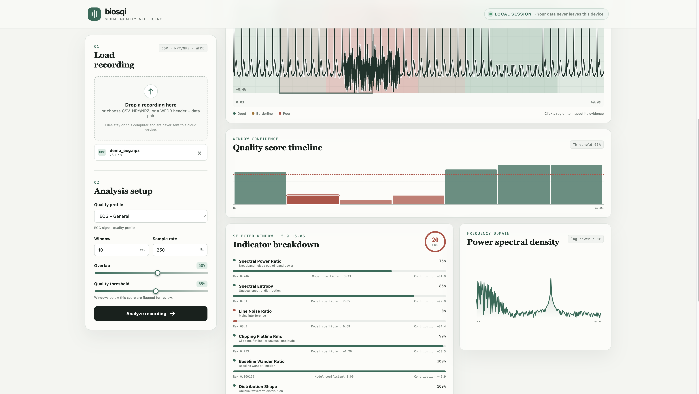

# biosqi

[](https://github.com/akshajbachu/biosqi/actions/workflows/ci.yml)
[](https://pypi.org/project/biosqi/)
[](https://www.python.org/)
[](https://akshajbachu.github.io/biosqi/)
[](LICENSE)
[](https://doi.org/10.5281/zenodo.23552709)

Transparent, calibrated biomedical signal-quality assessment for ECG, PPG, and
EEG recordings.

biosqi turns a long waveform into a window-aligned quality score, a mask a
downstream pipeline can consume, and explicit evidence about what may be wrong.
Instead of returning an unexplained “bad signal” flag, it exposes the spectral,
amplitude, drift, distribution, and periodicity indicators behind each
decision.

> [!IMPORTANT]
> biosqi is research software, not a medical device. It measures recording
> properties; it does not diagnose patients or determine clinical safety.

## What makes it useful

- **Explainable attribution:** identifies evidence consistent with mains
  interference, baseline wander/motion, clipping, flatline/dropout, unusual
  amplitude, and poor beat consistency.
- **Calibrated, versioned models:** logistic fusion followed by a monotone
  isotonic map. Model name and analysis settings travel with every result.
- **Multiple entry points:** typed Python library, scriptable CLI,
  self-contained HTML reports, and a polished local dashboard.
- **Research formats:** NumPy/NPZ and CSV in the base install; WFDB and EDF/BDF
  through an optional data extra.
- **Reproducible validation:** one command downloads public datasets,
  recomputes nested-CV metrics, fits the release model, and regenerates this
  README’s result block.

## Install

```bash
pip install "biosqi[data,ui]"
```

For development:

```bash
git clone https://github.com/akshajbachu/biosqi.git
cd biosqi
uv sync --extra dev
```

## Use the dashboard

```bash
biosqi view
```

Drop a recording into the browser, select ECG/PPG/EEG and its sample rate, then
inspect aligned waveform and quality timelines. Selecting a window reveals its
power spectrum, indicator evidence, and artifact attribution. Processing stays
on the local machine.



## Use the CLI

```bash
# Human-readable window table
biosqi score recording.csv --sample-rate 250 --signal-type ecg

# Complete machine-readable report
biosqi score recording.npz --signal-type ppg --json > result.json

# Sample-level mask and standalone HTML report
biosqi mask recording.hea --signal-type ecg --output mask.csv
biosqi report recording.hea --signal-type ecg --output report.html
```

## Use Python

```python
from biosqi.analysis import analyze
from biosqi.io import read_recording
from biosqi.types import SignalType

recording = read_recording("recording.npz", signal_type=SignalType.ECG)
result = analyze(recording, threshold=0.70)

print(result.scores)  # calibrated score for each window
print(result.mask)  # boolean window mask
print(result.windows[0].artifacts)
```

<!-- benchmark-results:start -->
## Reproducible validation

Numbers below are generated by `python benchmarks/run_all.py`; they are not
hand-entered. The Challenge metric uses nested calibration inside each outer
fold. Set B/C labels remain withheld and are not claimed as test results.

| Benchmark | Result |
| --- | ---: |
| CinC 2011 Set A records | 998 |
| 5-fold ROC AUC (95% bootstrap CI) | 0.819 (0.782-0.855) |
| Balanced accuracy | 0.758 |
| Brier score | 0.101 |
| NSTDB score/SNR correlation | 0.982 |
<!-- benchmark-results:end -->

## Reproduce every number

```bash
# Fast pipeline check on a balanced subset
uv run python benchmarks/run_all.py --quick

# Full Set A + all MIT-BIH NSTDB conditions
uv run python benchmarks/run_all.py
```

Public data is cached under `~/.cache/biosqi` (override with `BIOSQI_CACHE`).
The runner records provenance, uses nested calibration inside each outer
validation fold, writes JSON and SVG plots, updates this result block, and
stores the fitted model.

## Documentation

Full documentation is at
[akshajbachu.github.io/biosqi](https://akshajbachu.github.io/biosqi/),
including the [methodology](docs/methodology.md), [indicator
definitions](docs/indicators.md), [validation protocol](docs/validation.md),
limitations, and API reference.

## Contributing

Contributions are welcome. See [CONTRIBUTING.md](CONTRIBUTING.md) for
development setup and checks, and the [Code of Conduct](CODE_OF_CONDUCT.md).
Report security issues privately as described in [SECURITY.md](SECURITY.md).
Release history is in [CHANGELOG.md](CHANGELOG.md).

## Citation

If you use biosqi in research, please cite it. GitHub's **Cite this
repository** button (from [`CITATION.cff`](CITATION.cff)) provides APA and
BibTeX entries. The concept DOI
[10.5281/zenodo.23552709](https://doi.org/10.5281/zenodo.23552709) always resolves to the latest
version; each release also has its own version DOI on Zenodo.

## License

biosqi is released under the [MIT License](LICENSE). Dataset licenses remain
with their original providers.
